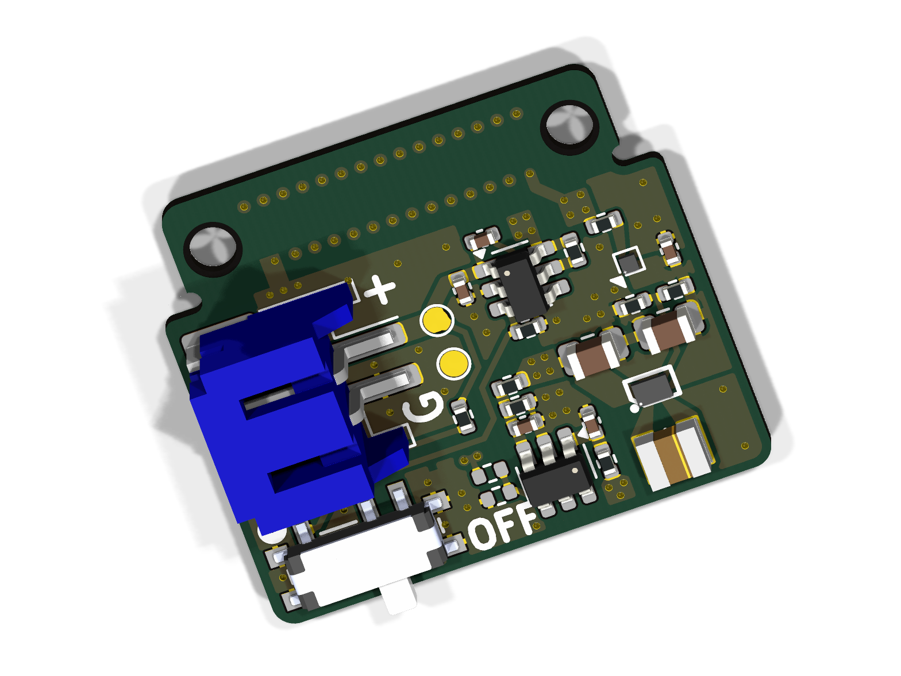

# Leafony AV06 1.8V〜5.5V

Leafony用電源リーフ「AV06 1.8V〜5.5V」のハードウェア設計データです。外部電源から3.3Vを生成する昇降圧回路と、入力電圧を監視するADC回路を備えています。

KiCadの回路図・基板データに加え、専用ライブラリ、3Dモデル、面付け基板、製造用データを収録しています。

## 基板の3D画像

| Top（表面） | Bottom（裏面・部品面） |
| :---: | :---: |
|  |  |

単体基板のKiCadデータから生成した3Dレンダリングです。

## 主な構成

| 機能 | 構成 |
| --- | --- |
| 電源入力 | JST PHコネクタ `S2B-PH-SM4-TB` |
| 電源スイッチ | `CUS-12TB`、ロードスイッチ `TPS22917DBV` |
| 昇降圧電源 | `TPS631010YBGR`による3.3V生成 |
| 出力側ダイオード | 理想ダイオード `MAX40200ANS` |
| 電圧監視 | I²C ADC `ADC081C027CIMK/NOPB`で、分圧した`VBATT`を測定 |
| Leafony接続 | Leafony Bus経由の3.3V供給とI²C接続 |
| 基板 | 4層、板厚0.8mm（単体基板の設計設定） |

## ファイル構成

主要なファイルは`kicad/leafony-av06-1v8-5v5/`にあります。

```text
kicad/leafony-av06-1v8-5v5/
├── leafony-av06-1v8-5v5.kicad_pro       # KiCadプロジェクト
├── leafony-av06-1v8-5v5.kicad_sch       # ルート回路図
├── leafony-av06-1v8-5v5.kicad_pcb       # 単体基板
├── input_conn.kicad_sch                # 電源入力・スイッチ
├── buck_boost.kicad_sch                # 昇降圧電源
├── adc.kicad_sch                       # 電圧監視ADC
├── leafony_bus.kicad_sch               # Leafony Bus接続
├── sym-lib-table                      # シンボルライブラリ設定
├── fp-lib-table                       # フットプリントライブラリ設定
├── lib/
│   ├── Leafony.kicad_sym               # 専用シンボル
│   ├── Leafony.pretty/                 # 専用フットプリント
│   └── 3dmodels/                      # 部品の3Dモデル
└── panelized/
    ├── leafony-av06-1v8-5v5-panelized.kicad_pro
    ├── leafony-av06-1v8-5v5-panelized.kicad_pcb
    ├── bom-leafony-av06-1v8-5v5-pcbgogo.xlsx
    └── Gerber/                        # Gerber・ドリル・部品配置データ
```

## KiCadで開く

ルート回路図・子回路図・単体基板はKiCad 10.0形式で保存されています。編集にはKiCad 10.0以降を使用してください。面付け基板はKiCad 8.0形式で保存されています。

1. このディレクトリ一式を取得します。
2. KiCadで[`leafony-av06-1v8-5v5.kicad_pro`](kicad/leafony-av06-1v8-5v5/leafony-av06-1v8-5v5.kicad_pro)を開きます。
3. プロジェクトマネージャーから回路図エディター、または基板エディターを開きます。
4. 回路図では、ルートシート内の各階層シートを開いて回路ブロックを確認します。

専用ライブラリは`fp-lib-table`と`sym-lib-table`に登録済みです。`${KIPRJMOD}/lib/`を参照するため、`lib/`を含むディレクトリ構成を維持してください。標準部品の3D表示にはKiCad標準3Dモデルも必要です。

## 製造用データ

[`panelized/`](kicad/leafony-av06-1v8-5v5/panelized/)に、面付け基板とPCBGOGO向け部品表を収録しています。[`Gerber/`](kicad/leafony-av06-1v8-5v5/panelized/Gerber/)には、各層のGerber、PTH／NPTHドリル、表裏の部品配置データ（`.pos`）があります。

設計変更後は、回路図のERCと基板のDRCを確認し、面付け基板・部品表・製造用データにも変更を反映してください。

## Gitで管理するファイル

回路図、基板、プロジェクト設定、専用ライブラリ、3Dモデル、製造用データを管理対象とします。ルートの`.gitignore`では、KiCadのローカル設定（`.kicad_prl`）、ロック、自動保存、バックアップ、OSやエディターの一時ファイルを除外しています。

KiCadプロジェクト内の既存の`.gitignore`には、ネットリスト、外部配線ツールの中間ファイル、XML／CSV出力の除外設定もあります。
